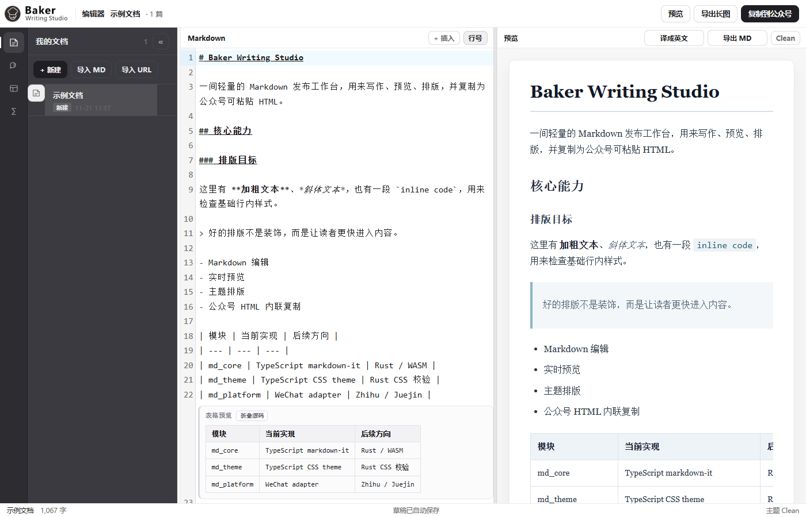
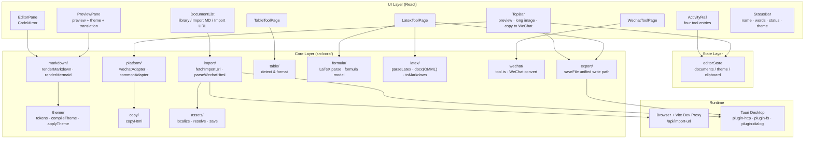

# Baker Writing Studio

**Languages:** [中文](README.md) | English

A Markdown workbench built around a personal writing flow: on top of an editor, live preview and themed output, it integrates three standalone tools — **WeChat Official Accounts → Markdown**, **Markdown table → Markdown / LaTeX**, and **LaTeX formula → LaTeX / Word (.docx)** — and strengthens the document library with local Markdown import.

[](LICENSE)
[](https://github.com/ingeniousfrog/Read2MD-Studio)
[](https://github.com/mo21cn/Read2MD-Studio/releases)

> **About this project**
> Baker Writing Studio is a fork of [ingeniousfrog/Read2MD-Studio](https://github.com/ingeniousfrog/Read2MD-Studio) (Apache License 2.0). The original project was created by ingeniousfrog and released under the Apache License 2.0; this fork rebrands, extends and localizes it while keeping the original `LICENSE` file and copyright notice intact. **When redistributing this software, keep the upstream `LICENSE` file and the original attribution.**
>
> Upstream copyright: Copyright (c) ingeniousfrog and contributors. Licensed under the Apache License, Version 2.0.



**Core workflow:**

```text
Markdown edit → Live preview → Theme styling → Platform HTML → Clipboard
Three standalone tools: WeChat → MD · Table → MD/LaTeX · Formula → LaTeX/Word
```

Available as a **Web app** (browser) and a **desktop app** (Tauri — a **Windows** installer is published today, macOS can be built locally). Business logic lives in the TypeScript `core/` layer; the UI only composes and interacts, which makes it easy to add adapters for other content platforms and file formats.

---

## Download and install

| Platform | Package | Status |
|----------|---------|--------|
| Windows 10/11 (x64) | [`Baker-Writing-Studio_0.3.0_x64-setup.exe`](https://github.com/mo21cn/Read2MD-Studio/releases/download/v0.3.0/Baker-Writing-Studio_0.3.0_x64-setup.exe) | ✅ Published (5.73 MB) |
| macOS Apple Silicon (arm64) | `Baker-Writing-Studio_0.3.0_aarch64.dmg` | Build it yourself on macOS, see [Development](#development) |
| Web | `npm run build` produces `dist/`; host it as static files | ✅ |

The installer is produced by the [Build Windows Installer](.github/workflows/build-windows.yml) workflow. You can also build it locally.

### Windows install notes

- For **Windows 10 / 11, 64-bit (x64)**
- **Microsoft Edge WebView2** must be installed (preinstalled on most Win10/11 systems; the installer prompts for it when missing)
- Run the NSIS installer and follow the wizard; launch from the Start menu or the desktop shortcut
- The installer is **not code-signed**, so Windows SmartScreen may report an unknown publisher — choose *More info → Run anyway*

### macOS install notes

No macOS package is published yet. A locally built dmg is **ad-hoc signed and not notarized**. If Safari reports the app as “damaged” or refuses to open it, run this in Terminal and try again:

```bash
xattr -cr "/Applications/Baker Writing Studio.app"
```

You can also **right-click Baker Writing Studio → Open** in Applications (confirm once on first launch).

---

## Usage

### Interface tour

The desktop and web builds share one interface:

| Area | Where | What it does |
|------|-------|--------------|
| **Activity rail** | Vertical icons on the far left | Four standalone tool entries: **Editor** / **WeChat → MD** / **Table** / **LaTeX** |
| **Top bar** | Horizontal strip on top | Brand mark, current document and view, **Preview** toggle, **Export long image**, **Copy to WeChat** |
| **Document sidebar** | Below the top bar, on the left | Document list plus **+ New** / **Import MD** / **Import URL** |
| **Workspace** | Middle | Editor (left) and preview (right), separated by a draggable divider; the three tool pages share the same canvas |
| **Status bar** | Bottom | Current document name, word count, operation status, current theme |

> The four rail entries are **four standalone tools**, not views of the same workspace. The editor stays alive in the background while you are on a tool page, and a tool's output can be sent back into the document in one click.

### Core workflow: from Markdown to a WeChat article

1. Create a document with **+ New** in the sidebar, or load existing content with **Import MD** / **Import URL**
2. Write Markdown in the editor on the left — **paste / drop images** directly, or use **+ Insert** (image, table, formula, link, divider) in the editor header
3. The preview on the right renders live; pick a theme from the dropdown in the preview header
4. Hit **Copy to WeChat** in the top bar — the pipeline runs again from scratch (theme wrapper → CSS inlining → HTML sanitization → math protection → image embedding) and writes both `text/html` and `text/plain`
5. Paste into the WeChat backend or any other rich-text editor

The preview DOM is **never** copied directly: every click re-runs the pipeline, so the output always matches the current theme and content.

### Document library and import

| Method | Entry | Notes |
|--------|-------|-------|
| New | Sidebar **+ New** | Creates a blank document |
| Local Markdown | Sidebar **Import MD** | Pick a `.md` / `.markdown` file; it becomes a document and switches to it |
| URL | Sidebar **Import URL** | Paste an article link. The desktop build fetches through an in-app HTTP channel with **no browser CORS limits**; the web dev server uses a local proxy, and a production deployment needs an equivalent API |
| WeChat article | Same as above | Converted to Markdown, keeping code blocks, formulas, tables, blockquotes and styled headings where possible |

Drafts and theme settings are saved locally and survive a refresh or a restart.

### Images

- **Paste / drop**: images pasted or dropped into the editor are stored as that document's local assets
- **Localized on import**: importing a URL downloads external images into the document's own `assets/{docId}/` directory and rewrites the Markdown to `baker-asset:` references
- **Preview and cleanup**: local references resolve in the preview; deleting a document removes its asset directory
- **Copy to WeChat**: external images are inlined as data URLs when possible; images that fail cross-origin need a manual upload in the WeChat backend

### Themes

- Three built-in themes: `clean` / `tech` / `wechat-card`
- The **theme config** panel fine-tunes tokens (font size, colors, spacing, heading styles) and adds or removes H1–H6 levels
- Custom themes can be saved as presets and exported / imported as JSON

### The three standalone tools

Switch with the activity rail.

| Tool | Purpose | Output |
|------|---------|--------|
| **WeChat → MD** | Paste WeChat article HTML or plain text | Clean Markdown (code blocks, formulas, lists and blockquotes preserved) |
| **Table** | Paste a Markdown / HTML / text-aligned table fragment | A normalized Markdown table, or a LaTeX `tabular` environment (output format and alignment switchable) |
| **LaTeX** | Paste LaTeX source or an image of a formula | Copy-ready LaTeX source, plus a Word `.docx` with **natively embedded OMML math** (the formula stays editable in Microsoft Word) |

The tool pages share the document library with the main editor: WeChat conversion results can be saved into the library in one click, and table / formula output can be copied or exported as a file.

### Full-text translation

**Translate to English / Translate to Chinese** in the preview header translates the whole document.

- The target language is derived from the document's main language (detected with code blocks removed first)
- **Structure protection**: code blocks are skipped whole; inline code, `$...$` formulas, link and image URLs and HTML tags are replaced by placeholders and restored verbatim afterwards
- **Bilingual documents**: a side-by-side Chinese/English view de-duplicates equivalent translations and keeps the hand-written version
- Progress is shown as `done/total` and can be cancelled; a cancelled run leaves the document untouched
- The button turns into **Restore original** once done; it disappears if the document was edited by hand, so nothing gets overwritten
- The engine is a public Google Translate endpoint, so **no API key is needed**; a failed line keeps its original text and the status bar reports it, and a fully failed run leaves the document unchanged

### Export

| Artifact | Entry | Desktop behaviour |
|----------|-------|-------------------|
| Markdown | Preview header **Export MD** | Native save dialog → `.md` with a UTF-8 BOM (Excel / Notepad read it correctly) |
| Long image | Top bar **Export long image** | Native save dialog → high-resolution PNG of the whole preview |
| LaTeX source | LaTeX page **Export .tex** | Native save dialog → `.tex` without a BOM (LaTeX compilers reject BOMs) |
| Word document | LaTeX page **Export Word** | Native save dialog → `.docx` |
| Theme JSON | Theme config menu **Export theme** | Native save dialog → `.json` |

> Every desktop export goes through the **native save dialog**; the web build falls back to a browser download.

### Where the data lives

| Data | Desktop | Web |
|------|---------|-----|
| Documents, themes, drafts | `%LOCALAPPDATA%\com.baker.writing.studio\EBWebView\Default\Local Storage\` | Browser localStorage |
| Localized images | `%APPDATA%\com.baker.writing.studio\read2md-studio\assets\{docId}\` | Browser IndexedDB |
| Logs | `%LOCALAPPDATA%\com.baker.writing.studio\logs\` | Browser console |

> The `read2md-studio` segment in the image path is the pre-rebrand folder name. It is kept verbatim so images in documents created before the rebrand keep resolving — it is not a leftover bug.

**No cloud sync, no accounts**: data stays on this machine. To move machines, export the Markdown manually.

### Desktop vs web

| Capability | Web | Desktop (Tauri) |
|------------|-----|-----------------|
| Markdown edit / preview / themes | ✅ | ✅ |
| Copy to WeChat | ✅ | ✅ (native clipboard API, steadier for long posts) |
| URL import (with image localization) | Dev proxy only; production needs your own API | ✅ Native HTTP, no CORS limits |
| Local Markdown import | ✅ | ✅ |
| The three standalone tools | ✅ | ✅ |
| Formula → Word (native `.docx` + OMML) | ✅ | ✅ |
| Export to disk | Browser download | ✅ Native save dialog |
| Offline use | ✗ | ✅ |

### FAQ

**Q: SmartScreen says "unknown publisher" during install.**
The installer is not code-signed. Choose *More info → Run anyway*.

**Q: Importing a WeChat link fails with a verification prompt.**
Some WeChat articles trigger a human check for unusual network environments. Try a different network, or paste the article content into the **WeChat → MD** tool instead.

**Q: Images are broken after copying to WeChat.**
The image host does not allow cross-origin embedding. Image localization covers imported and pasted images only; links you type by hand have to be uploaded in the WeChat backend, or the whole article can be re-imported with **Import URL**.

**Q: Translating a long document is slow or fails halfway.**
Translation goes through a public endpoint with rate limits. Failed lines keep their original text and the status bar reports them; split long documents into parts.

**Q: Formulas do not show up in the preview.**
MathJax loads on first use, so give it a moment. If nothing appears, check whether the resources it needs are reachable.

---

## Development

### Web

```bash
npm install
npm run dev -- --host 127.0.0.1 --port 3000
```

Open http://127.0.0.1:3000/

### Desktop

**Requirements:**

- [Rust](https://www.rust-lang.org/tools/install) 1.77+
- macOS: Xcode Command Line Tools
- Windows: [Visual Studio 2022 Build Tools](https://visualstudio.microsoft.com/downloads/) with the *Desktop development with C++* workload (MSVC compiler and Windows SDK); the runtime needs **Microsoft Edge WebView2**

```bash
# Development (native window)
npm run tauri:dev

# Local build (the artifact depends on the host platform)
npm run tauri:build          # picks the target for the current platform: Windows → nsis, macOS → dmg
npm run tauri:build:nsis     # Windows NSIS installer only
npm run tauri:build:dmg      # macOS DMG image only

# macOS: src-tauri/target/release/bundle/dmg/Baker Writing Studio_0.3.0_aarch64.dmg
# Windows: src-tauri/target/release/bundle/nsis/Baker Writing Studio_0.3.0_x64-setup.exe
```

> `bundle.targets` cannot list NSIS and DMG at the same time: NSIS only builds on Windows and DMG only on macOS, so listing both makes `tauri build` fail on either platform. The config keeps the platform default (`"all"`) and `scripts/build-desktop.mjs` passes the target for the current platform explicitly via `--bundles`.

### Production build (web)

```bash
npm run build     # outputs dist/
npm run preview   # preview the production build locally
```

### Development commands

| Command | Description |
|---------|-------------|
| `npm run dev` | Start the Vite dev server |
| `npm run build` | TypeScript check + production build |
| `npm run preview` | Preview the production build |
| `npm run tauri:dev` | Tauri development mode (native window) |
| `npm run tauri:build` | Build the desktop installer for the current platform (Windows: exe; macOS: dmg) |
| `npm run tauri:build:nsis` | Build the Windows NSIS installer (`.exe`) only |
| `npm run tauri:build:dmg` | Build the macOS DMG image (`.dmg`) only |
| `npm test` | Run the unit tests (Vitest) |
| `npm run lint` | ESLint |
| `npm run version:sync` | Copy the `package.json` version into the Tauri and Cargo manifests |
| `npm run verify:version` | Check that all three version fields agree (CI runs this) |

---

## Architecture

The project has four layers: **UI components**, **state**, **core business logic** and **runtime**.



### Directory layout

```text
src/
  App.tsx                 # Layout: activity rail + top bar + view slot + status bar
  components/             # Pure UI components, no business rules
    ActivityRail.tsx      # Left rail: editor / WeChat / table / LaTeX
    TopBar.tsx            # Top bar: brand, view, preview toggle, long image, copy to WeChat
    StatusBar.tsx         # Bottom status bar
    CanvasPane.tsx        # Canvas shared by the tool pages and the editor
    WorkspaceSplit.tsx    # Draggable split
    DocumentList.tsx      # Document list, Import MD / Import URL, rename / delete
    EditorPane.tsx        # Markdown editor (image paste/drop, slash commands)
    editorImageExtension.ts / editorBlockWidgets.ts / editorInlineWidgets.ts
    editorSlashCommands.ts / editorSelectionTools.ts
    PreviewPane.tsx       # Preview + theme picker + full-text translation + export MD
    ThemePanel.tsx        # Theme configuration panel
    ThemeSelector.tsx     # Theme dropdown (including saved custom themes)
    HeadingLevelsEditor.tsx
    WechatToolPage.tsx    # WeChat → Markdown tool
    TableToolPage.tsx     # Table → MD/LaTeX tool
    LatexToolPage.tsx     # LaTeX → LaTeX/Word tool
    BrandLogo.tsx         # chef-hat mark
    ImportDialog.tsx      # URL import dialog
    InsertMenu.tsx / SelectionBubble.tsx / DocTypeIcon.tsx / PaneHeader.tsx
  core/
    markdown/             # Markdown → HTML, math and Mermaid
    theme/                # Theme tokens, CSS compile, wrap HTML
    platform/             # Platform adapters (currently WeChat)
    copy/                 # Clipboard write
    import/               # URL fetch, HTML parse, to Markdown
    assets/               # Image download, localization, preview resolve, paste save
    export/               # saveFile.ts — unified write path
    document/             # Document type definitions
    wechat/               # WeChat → MD tool implementation
    table/                # Table → MD/LaTeX tool implementation
    formula/              # Formula model and serialization
    latex/                # LaTeX parsing, Word (OMML) generation, to Markdown
    translate/            # Full-text translation: segmentation, placeholder protection, request, write-back
    editor/               # Editor helper logic
    tools/                # Tool-level state such as drafts
  store/
    editorStore.ts        # Zustand global state + localStorage persistence
  fixtures/               # Sample document
  i18n/                   # i18next setup and the Chinese language bundle
  styles/
    globals.css
server/                   # Dev only: Node fetch scripts called by Vite middleware
src-tauri/                # Tauri desktop shell (Rust)
scripts/
  sync-version.mjs        # Single source of truth for the version
  build-desktop.mjs       # Picks the bundle target for the platform
```

**Design principle:** React components only call `core/` APIs. Rendering, theming, platform adaptation, sanitization, clipboard and write-to-disk logic stay decoupled from the UI, which makes them easy to test and to extend.

### Core data flows

**1. Preview rendering**

```text
Markdown
  → renderMarkdown()        # markdown-it + custom mathPlugin
  → rawHtml
  → applyThemeHtml()        # wrap .baker-article + theme CSS
  → preview DOM
```

Math is rendered as **self-contained SVG** by MathJax (`fontCache: "none"`), so pasted content does not lose `<use>` references.

**2. Copy to WeChat**

```text
rawHtml
  → applyThemeHtml()
  → buildWechatOutput()
      ① Extract math containers as blocks (avoids nested SVG breakage)
      ② juice inline CSS
      ③ DOMPurify sanitize
      ④ Try external images → data URLs
      ⑤ Restore math HTML
  → copyHtml()              # writes text/html + text/plain
```

**3. URL import**

```text
User enters a URL
  → fetchImportUrl()
      Browser: /api/import-url (Vite → server/*.mjs)
      Desktop: @tauri-apps/plugin-http
  → parseWechatHtml() / parseGenericHtml()
      Extract code blocks, math placeholders
  → htmlToMarkdown()        # Sitdown + Turndown
  → localizeDocumentImages() # Download external images to assets/{docId}/
  → Write to the editor
```

**4. Unified write path (export)**

```text
Any export action
  → core/export/saveFile.ts
      Web: Blob → a[download]
      Desktop: base64 → IPC → the save_bytes Rust command
              → native save dialog for the path → std::fs::write
```

The path **always** comes from the native dialog, so the command never writes anywhere the user did not point at.

---

## Contributing

See [CONTRIBUTING.md](CONTRIBUTING.md). Before submitting a change, make sure these pass:

```bash
npx tsc -b          # type check
npm run lint        # ESLint
npm test            # unit tests
npm run verify:version
```

For security issues, see [SECURITY.md](SECURITY.md).

---

## Changelog

The full changelog lives in [CHANGELOG.md](CHANGELOG.md).

---

## Acknowledgments

This project stands on top of a number of excellent open-source projects:

| Project | Role |
|---------|------|
| [markdown-it](https://github.com/markdown-it/markdown-it) | Markdown parsing and HTML rendering |
| [MathJax](https://github.com/MathJax/MathJax) | LaTeX → SVG |
| [CodeMirror](https://github.com/codemirror/dev) / [react-codemirror](https://github.com/uiwjs/react-codemirror) | Editor core and React binding |
| [highlight.js](https://github.com/highlightjs/highlight.js) | Code block syntax highlighting |
| [juice](https://github.com/Automattic/juice) | CSS inlining (required by WeChat rich text) |
| [DOMPurify](https://github.com/cure53/DOMPurify) | HTML sanitization |
| [Sitdown](https://github.com/mdnice/sitdown) | WeChat / Zhihu HTML → Markdown |
| [Turndown](https://github.com/mixmark-io/turndown) | Generic HTML → Markdown |
| [Tauri](https://github.com/tauri-apps/tauri) | Cross-platform desktop shell |
| [Mermaid](https://github.com/mermaid-js/mermaid) | Flowchart / sequence rendering |
| [docx](https://github.com/dolanmiu/docx) · [math](https://www.npmjs.com/package/math) | Word `.docx` generation and OMML math |
| [React](https://github.com/facebook/react) · [Vite](https://github.com/vitejs/vite) · [Zustand](https://github.com/pmndrs/zustand) | UI framework, build tool and state management |

Special thanks to **[ingeniousfrog/Read2MD-Studio](https://github.com/ingeniousfrog/Read2MD-Studio)** — this project is a re-release built on top of that foundation. If we missed anyone, please open an issue.

---

## License

This project is licensed under the [Apache License 2.0](LICENSE).

The original README and brand assets of upstream projects remain the copyright of their respective authors; this fork re-releases the work while keeping the original `LICENSE` file and upstream copyright notice intact. Third-party packages have their own licenses; keep the `LICENSE` file when redistributing.

---

## Current limitations

- **Mermaid → WeChat copy**: diagrams render in the preview, but copying to WeChat still pastes Mermaid as code or text rather than as an embedded image/SVG
- **No image CDN yet**: the desktop build and the web dev server can store images locally (`assets`, on import and on paste), but some external images still fail to inline when copying to WeChat because of CORS, and need a manual upload in the backend
- **Production web deployment** has no URL fetch proxy and no complete image localization; use the desktop build for image-heavy workflows
- Only the WeChat copy adapter is implemented; Zhihu / Juejin and friends are still to come
- No cloud sync and no user accounts; images and drafts stay on the local machine
- The macOS desktop build is ad-hoc signed and not notarized; the Windows installer is unsigned, so SmartScreen may report an unknown publisher
- Some WeChat imports may trigger environment verification, depending on the network
- **Translation depends on a public endpoint**: no API key is needed, but long documents are limited by that endpoint's rate limit; failed lines keep their original text and are reported
- **Chinese-only interface**: the early Chinese/English switch was removed and the UI text is locked to Chinese
