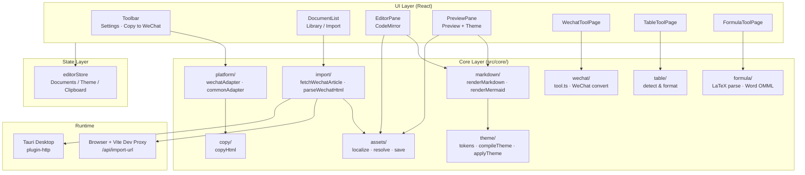

# Baker Writing Studio

**Languages:** [中文](README.md) | English

A Markdown workbench tailored to individual writing workflows: built on top of an editor, live preview, and themed output, Baker Writing Studio integrates three standalone tools — **WeChat Official Accounts → Markdown**, **Markdown table → Markdown / LaTeX**, and **LaTeX formula → LaTeX / Word (.docx)** — plus a one-click **local Markdown import** into the document library.

[](LICENSE)
[](https://github.com/ingeniousfrog/Read2MD-Studio)

> **About this project**
> Baker Writing Studio is a private fork of [ingeniousfrog/Read2MD-Studio](https://github.com/ingeniousfrog/Read2MD-Studio) (Apache License 2.0). The original project was created by ingeniousfrog and released under the Apache License 2.0; this fork rebrands, extends, and localizes the project while keeping the original `LICENSE` file and copyright notice intact. **When redistributing, keep the upstream `LICENSE` file and the original attribution.**
>
> Upstream copyright: Copyright (c) ingeniousfrog and contributors. Licensed under the Apache License, Version 2.0.

**Core workflow:**

```text
Markdown edit → Live preview → Theme styling → Platform HTML → Clipboard
Three standalone tools: WeChat → MD · Table → MD/LaTeX · Formula → LaTeX/Word
```

Available as a **Web app** (browser) and **desktop app** (Tauri, **macOS** / **Windows**). Business logic lives in the TypeScript `core/` layer; the UI only composes and interacts — making it easy to add adapters for other content platforms and file formats.

### Web vs desktop

| Capability | Web | Desktop (Tauri) |
|------------|-----|-----------------|
| Markdown edit / preview / themes | ✅ | ✅ |
| Copy to WeChat | ✅ | ✅ |
| URL import (with image localization) | Dev proxy only; production needs your own API | ✅ Native HTTP, no CORS |
| Local Markdown import | ✅ | ✅ |
| Three Web tools (WeChat / Table / Formula) | ✅ | ✅ |
| Formula → Word (native `.docx` + OMML) | ✅ | ✅ |

---

## Download

| Platform | Notes |
|----------|-------|
| [GitHub Releases](https://github.com/mo21cn/Read2MD-Studio/releases) | **macOS Apple Silicon (arm64):** `Baker Writing Studio_0.3.0_aarch64.dmg` |
| Same | **Windows 10/11 (x64):** `Baker Writing Studio_0.3.0_x64-setup.exe` |
| Web | Run `npm run dev` locally, or `npm run build` and deploy `dist/` |

### macOS install notes

The desktop build is **ad-hoc signed and not notarized**. If Safari shows “damaged” or the app won’t open after download, run this in Terminal and try again:

```bash
xattr -cr "/Applications/Baker Writing Studio.app"
```

You can also **right-click Baker Writing Studio → Open** in Applications (confirm once on first launch). If it still fails, remove the old app and reinstall the latest dmg from Releases.

### Windows install notes

- For **Windows 10 / 11, 64-bit (x64)**
- Requires **Microsoft Edge WebView2** (usually preinstalled on Win10/11)
- Run `Baker Writing Studio_0.3.0_x64-setup.exe` and follow the NSIS installer; launch from the Start menu or desktop shortcut

---

## Features

### Main editor

- **Editor**: CodeMirror 6 with Markdown syntax highlighting; **paste / drag-and-drop images** into local assets
- **Preview**: `markdown-it` rendering, MathJax SVG math, highlight.js code blocks; **live Mermaid diagrams** (with auto-fix for bracket labels in node text)
- **Themes**: Built-in `clean` / `tech` / `wechat-card`, custom tokens, JSON import/export, dynamic heading levels (H1–H6 add/remove)
- **Document library**: Multi-document management; drafts and theme settings auto-saved to `localStorage`
- **Local Markdown import**: An **Import MD** button on the document sidebar (just before **Import URL**) lets you pick `.md` / `.markdown` files and add them as new documents in one step
- **URL import**: WeChat articles / generic pages → Markdown (math and code blocks preserved; WeChat HTML keeps tables, blockquotes, styled headings when possible)
- **Image localization**: External images downloaded to `assets/{docId}/` on import; Markdown uses `baker-asset:` URLs; preview resolves them and assets are removed when a document is deleted
- **WeChat copy**: CSS inlining, HTML sanitization, math SVG protection, external images inlined as data URLs when possible
- **Desktop**: Tauri native window; URL import via HTTP plugin without browser CORS; local images previewed via the asset protocol
- **Long-image export**: Export the Preview pane as PNG in one click
- **Layout**: Toolbar, view tabs, document sidebar, and pane headers stay fixed; only editor and preview content scroll

### Three Web tools (top tab switcher)

| Tool | Entry | Purpose |
|------|-------|---------|
| **WeChat → MD** | `Wechat` tab | Paste WeChat Official Account article HTML or plain text; auto-convert to clean Markdown (preserving code blocks, math, lists, blockquotes) |
| **Table → MD / LaTeX** | `Table` tab | Detect Markdown / HTML / text-aligned table fragments and emit a normalized Markdown table or a LaTeX `tabular` environment (toggleable output and alignment) |
| **Formula → LaTeX / Word** | `Formula` tab | Parse LaTeX / image formulas; output copy-ready LaTeX source, plus a Word `.docx` with **natively embedded OMML math** that you can keep editing in Microsoft Word |

The tool pages share the document library with the main editor: WeChat → MD conversion results can land in the library directly, and Table / Formula outputs can be copied or exported as files in one click.

---

## Changelog

### v0.3.0 (current / Baker Writing Studio)

- **Rebrand**: From Read2MD Studio to Baker Writing Studio — new chef-hat mark, grayscale palette, dark sidebar
- **Three Web tools**: WeChat → MD, Table → MD/LaTeX, Formula → LaTeX/Word
- **Formula → Word export**: Generates a `.docx` with native OMML formulas via `docx` + `math`, fully editable in Microsoft Word
- **Local Markdown import**: New **Import MD** button on the document sidebar — pick an `.md` file and create a new document in one click
- **Bilingual UI**: Toolbar language switch; full i18n across the app
- **Mermaid stability**: Live preview; diagrams rasterized to images when copying for WeChat
- **WeChat import fixes**: List items, display math, blockquote raw HTML leaks
- **WeChat copy fix**: Desktop native clipboard API; long posts with Mermaid copy more reliably
- **Windows desktop**: x64 installer (`.exe`) on Releases

### v0.1.0 (original Read2MD Studio release)

- Initial release: Markdown edit/preview/themes, WeChat copy, URL import, image localization, macOS dmg

---

## Architecture

The project has four layers: **UI components**, **state**, **core business logic**, and **runtime**.



### Directory layout

```text
src/
  App.tsx                 # Layout: toolbar + view tabs + doc sidebar + editor/preview split
  components/             # Pure UI; no business rules
    DocumentList.tsx      # Doc list, Import MD / Import URL, rename/delete menu
    EditorPane.tsx        # Markdown editor (paste/drag images)
    editorImageExtension.ts
    PreviewPane.tsx       # Preview + theme picker/config
    ThemePanel.tsx        # Categorized theme config panel
    HeadingLevelsEditor.tsx
    Toolbar.tsx           # Settings + Copy to WeChat
    WorkspaceSplit.tsx    # Draggable split pane
    ViewTabs.tsx          # Top tab switcher (Editor / Wechat / Table / Formula)
    WechatToolPage.tsx    # WeChat → Markdown tool
    TableToolPage.tsx     # Table → MD/LaTeX tool
    FormulaToolPage.tsx   # Formula → LaTeX/Word tool
    BrandLogo.tsx         # chef-hat mark + Baker Writing Studio wordmark
    ImportDialog.tsx      # URL import dialog
  core/
    markdown/             # Markdown → HTML, math and Mermaid
    theme/                # Theme tokens, CSS compile, wrap HTML
    platform/             # Platform adapters (currently WeChat)
    copy/                 # Clipboard write
    import/               # URL fetch, HTML parse, to Markdown
    assets/               # Image download, localization, preview resolve, paste save
    document/             # Document type definitions
    wechat/               # WeChat → MD tool implementation
    table/                # Table → MD/LaTeX tool implementation
    formula/              # Formula → LaTeX/Word tool implementation
  store/
    editorStore.ts        # Zustand global state + localStorage persistence
  styles/
    globals.css
server/                   # Dev only: Node fetch scripts for Vite middleware
src-tauri/                # Tauri desktop shell (Rust)
```

**Design principle:** React components only call `core/` APIs. Rendering, themes, platform adaptation, sanitization, clipboard logic, and tool implementations stay decoupled from the UI for easier testing and extension.

---

## Core data flows

### 1. Preview rendering

```text
Markdown
  → renderMarkdown()        # markdown-it + custom mathPlugin
  → rawHtml
  → applyThemeHtml()        # wrap .baker-article + theme CSS
  → Preview DOM
```

Math is rendered as **self-contained SVG** via MathJax (`fontCache: "none"`) so pasted content does not lose `<use>` references.

### 2. Copy to WeChat

```text
rawHtml
  → applyThemeHtml()
  → buildWechatOutput()
      ① Extract math containers as blocks (avoid nested SVG breakage)
      ② juice inline CSS
      ③ DOMPurify sanitize
      ④ Try external images → data URLs
      ⑤ Restore math HTML
  → copyHtml()              # Write text/html + text/plain
```

The preview DOM is **not** copied directly. Each “Copy to WeChat” click runs the pipeline above for consistent output.

### 3. URL import

```text
User enters URL
  → fetchImportUrl()
      Browser: /api/import-url (Vite → server/*.mjs)
      Desktop: @tauri-apps/plugin-http
  → parseWechatHtml() / parseGenericHtml()
      Extract code blocks, math placeholders
  → htmlToMarkdown()        # Sitdown + Turndown
  → localizeDocumentImages() # Download external images to assets/{docId}/
  → Write to editor
```

### 4. Local Markdown import

```text
User clicks Import MD on the sidebar
  → <input type="file" accept=".md,.markdown">
  → Read file content (FileReader)
  → editorStore.importMarkdown({ title, content })
      Create a new document, switch to it, write into the editor
  → resolveMarkdownAssetUrls() runs async (no-op when there are no assets)
```

### 5. Image assets

```text
Import external images / editor paste·drop
  → localizeDocumentImages() / saveUserImage()
      Desktop: AppData/baker-writing-studio/assets/{docId}/
      Web dev: IndexedDB
  → Markdown references baker-asset:image-001.webp
  → Preview resolveMarkdownAssetUrls() → convertFileSrc (desktop asset protocol)
  → Copy inlineAssets() tries data URL conversion
  → Delete document → deleteDocumentAssetsDir()
```

### 6. Formula → Word export

```text
LaTeX / image formula
  → core/formula/ parse
  → intermediate AST
  → docx + math output
      .docx (with embedded OMML math)
  → Browser Blob → a[download]
  → Desktop Tauri dialog + fs write to the user-chosen path
```

---

## Usage

### Web

```bash
npm install
npm run dev -- --host 127.0.0.1 --port 3000
```

Open http://127.0.0.1:3000/

1. Write or paste Markdown in the left editor (**paste / drag images** supported)
2. See live preview on the right
3. Pick a theme at the top of the preview; use “Theme config” to fine-tune
4. Click **“Copy to WeChat”** in the toolbar
5. Paste into the WeChat backend or another rich-text editor
6. Switch to the top tabs (`Wechat` / `Table` / `Formula`) to use the three standalone tools; follow the on-page instructions to paste input and generate output

**URL import:** Document sidebar → Import URL → paste article URL. In dev mode, a local proxy fetches the page; for production Web deploy you need an equivalent API or use the desktop app. For image-heavy articles, prefer the **desktop app** so WeChat images are fully localized.

### Desktop (macOS / Windows)

**Requirements:** [Rust](https://www.rust-lang.org/tools/install) 1.77+; macOS also needs Xcode Command Line Tools

```bash
# Development
npm run tauri:dev

# Local build (output depends on host OS)
npm run tauri:build
# macOS: src-tauri/target/release/bundle/dmg/Baker Writing Studio_0.3.0_aarch64.dmg
# Windows: src-tauri/target/release/bundle/nsis/Baker Writing Studio_0.3.0_x64-setup.exe
```

Current version: **0.3.0**. Pre-built installers: [Releases](https://github.com/mo21cn/Read2MD-Studio/releases) (macOS dmg / Windows exe).

### Production build (Web)

```bash
npm run build    # Output dist/
npm run preview  # Preview dist locally
```

---

## Development commands

| Command | Description |
|---------|-------------|
| `npm run dev` | Start Vite dev server |
| `npm run build` | TypeScript check + production build |
| `npm run preview` | Preview production build |
| `npm run tauri:dev` | Tauri dev mode (native window) |
| `npm run tauri:build` | Build desktop installer (macOS: dmg; Windows: exe) |

---

## Acknowledgments

This project builds on many excellent open-source libraries:

| Project | Role |
|---------|------|
| [markdown-it](https://github.com/markdown-it/markdown-it) | Markdown parse and HTML render |
| [MathJax](https://github.com/mathjax/MathJax) | LaTeX → SVG |
| [CodeMirror](https://github.com/codemirror/dev) / [react-codemirror](https://github.com/uiwjs/react-codemirror) | Editor core and React binding |
| [highlight.js](https://github.com/highlightjs/highlight.js) | Code block highlighting |
| [juice](https://github.com/Automattic/juice) | CSS inlining (required for WeChat rich text) |
| [DOMPurify](https://github.com/cure53/DOMPurify) | HTML sanitization before copy |
| [Sitdown](https://github.com/mdnice/sitdown) | WeChat / Zhihu HTML → Markdown |
| [Turndown](https://github.com/mixmark-io/turndown) | Generic HTML → Markdown |
| [Tauri](https://github.com/tauri-apps/tauri) | Cross-platform desktop shell |
| [Mermaid](https://github.com/mermaid-js/mermaid) | Flowchart / sequence preview rendering |
| [docx](https://github.com/dolanmiu/docx) · [math](https://www.npmjs.com/package/math) | Word `.docx` generation and OMML math |
| [React](https://github.com/facebook/react) · [Vite](https://github.com/vitejs/vite) · [Zustand](https://github.com/pmndrs/zustand) | UI, bundler, state |

Special thanks to **[ingeniousfrog/Read2MD-Studio](https://github.com/ingeniousfrog/Read2MD-Studio)** — this project is a private re-release built on top of that foundation.

If we missed anyone, please open an Issue.

---

## License

This project is licensed under the [Apache License 2.0](LICENSE).

The original README and brand assets of upstream projects remain the copyright of their respective authors; this fork re-releases the work while keeping the original `LICENSE` file and upstream copyright notice intact. Third-party packages have their own licenses; keep the `LICENSE` file when redistributing.

---

## Current limitations

- **Mermaid → WeChat copy**: Diagrams render in preview, but copy-to-WeChat still pastes Mermaid as code/text, not as embedded images/SVG
- **No image CDN yet**: Desktop and Web dev can store images as local `assets` (download on import, paste to insert), but some external images may still fail to inline when copying to WeChat due to CORS — manual upload in the backend may be needed
- **Production Web deploy** has no URL fetch proxy or full image localization; use the desktop app for image-heavy workflows
- Only WeChat copy adapter implemented; Zhihu / Juejin etc. planned
- No cloud sync or user accounts; drafts and images stay on the local machine
- macOS desktop build is ad-hoc signed and not notarized; Windows pre-built installer on [Releases](https://github.com/mo21cn/Read2MD-Studio/releases)
- Some WeChat article imports may trigger environment verification depending on network
