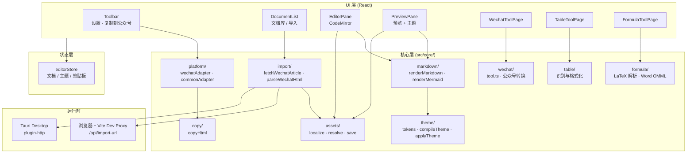

# Baker Writing Studio

**语言 / Languages：** 中文 | [English](README-EN.md)

面向个人写作工作流的 Markdown 工作台：在编辑器、实时预览与主题化输出之上，集成 **微信公众号 → Markdown**、**Markdown 表格 → Markdown / LaTeX**、**LaTeX 公式 → LaTeX / Word (.docx)** 三个独立工具，并补强文档库的本地 Markdown 导入能力。

[](LICENSE)
[](https://github.com/ingeniousfrog/Read2MD-Studio)

> **关于本项目**
> Baker Writing Studio 是对 [ingeniousfrog/Read2MD-Studio](https://github.com/ingeniousfrog/Read2MD-Studio)（Apache License 2.0）的私有 fork。原项目由 ingeniousfrog 创建并以 Apache License 2.0 发布；本 fork 在保留原始 `LICENSE` 与版权声明的前提下进行了品牌重构、功能扩展与本地化定制。**分发本软件时请完整保留上游 `LICENSE` 文件与原作者致谢。**
>
> 上游版权：Copyright (c) ingeniousfrog and contributors. Licensed under the Apache License, Version 2.0.

**核心工作流：**

```text
Markdown 编辑 → 实时预览 → 主题样式 → 平台适配 HTML → 剪贴板
三个独立工具：WeChat → MD · Table → MD/LaTeX · Formula → LaTeX/Word
```

提供 **Web 版**（浏览器访问）和 **桌面版**（Tauri 打包，支持 **macOS** / **Windows**）。业务逻辑集中在 TypeScript `core/` 层，UI 只负责组合与交互，便于扩展多个内容平台与文件格式适配器。

### Web 版与桌面版差异

| 能力 | Web 版 | 桌面版（Tauri） |
|------|--------|-----------------|
| Markdown 编辑 / 预览 / 主题 | ✅ | ✅ |
| 复制到公众号 | ✅ | ✅ |
| URL 导入（含图本地化） | 开发态有代理；生产需自建 API | ✅ 原生 HTTP，无 CORS 限制 |
| 本地 Markdown 导入 | ✅ | ✅ |
| 三个 Web 工具（WeChat / Table / Formula） | ✅ | ✅ |
| 公式 → Word（原生 `.docx` + OMML） | ✅ | ✅ |

---

## 下载

| 平台 | 说明 |
|------|------|
| [GitHub Releases](https://github.com/mo21cn/Read2MD-Studio/releases) | **macOS Apple Silicon (arm64)**：`Baker Writing Studio_0.3.0_aarch64.dmg` |
| 同上 | **Windows 10/11 (x64)**：`Baker Writing Studio_0.3.0_x64-setup.exe` |
| Web | `npm run dev` 本地启动，或自行 `npm run build` 后部署 `dist/` |

### macOS 安装提示

桌面版当前为 **ad-hoc 签名、未公证**。若 Safari 下载后提示「已损坏」或无法打开，请在终端执行后重试：

```bash
xattr -cr "/Applications/Baker Writing Studio.app"
```

也可在「应用程序」中 **右键 Baker Writing Studio → 打开**（首次需确认一次）。若仍失败，删除旧版后重新从 Releases 下载最新 dmg 安装。

### Windows 安装提示

- 适用于 **Windows 10 / 11，64 位（x64）**
- 需要系统已安装 **Microsoft Edge WebView2**（Win10/11 通常已自带）
- 双击 `Baker Writing Studio_0.3.0_x64-setup.exe` 运行 NSIS 安装向导，完成后从开始菜单或桌面快捷方式启动

---

## 功能概览

### 主编辑器

- **编辑器**：CodeMirror 6 + Markdown 语法高亮；支持 **粘贴 / 拖放图片** 插入本地资源
- **预览**：`markdown-it` 渲染，MathJax SVG 公式，highlight.js 代码高亮；**Mermaid 图表**实时渲染（含方括号标签自动修复）
- **主题**：内置 `clean` / `tech` / `wechat-card`，支持自定义 token、JSON 导入导出、动态标题级别（H1–H6 可增删）
- **文档库**：多文档管理，草稿与主题配置自动保存至 `localStorage`
- **本地 Markdown 导入**：文档侧栏的 **Import MD** 按钮支持选择 `.md` / `.markdown` 文件，一键建档（位于「Import URL」之前）
- **URL 导入**：公众号文章 / 通用网页 → Markdown（含公式、代码块保护；公众号 HTML 尽量保留表格、引用块、彩色标题等样式）
- **图片本地化**：导入时自动下载外链图至每篇文档的 `assets/{docId}/`；Markdown 使用 `baker-asset:` 引用，预览与删除文档时自动解析 / 清理
- **公众号复制**：CSS 内联、HTML 消毒、公式 SVG 保护、外链图片尝试内嵌为 data URL
- **桌面端**：Tauri 原生窗口，URL 导入走 HTTP 插件，无浏览器 CORS 限制；本地图片通过 asset 协议预览
- **导出长图**：一键将当前预览渲染结果导出为 PNG
- **布局**：顶部工具栏、左侧文档边栏与各面板标题栏固定，仅编辑区 / 预览正文滚动

### 三个 Web 工具（顶部 Tab 切换）

| 工具 | 入口 | 主要用途 |
|------|------|----------|
| **WeChat → MD** | `Wechat` Tab | 粘贴微信公众号文章 HTML 或纯文本，自动转换为干净的 Markdown（保留代码块、公式、列表、引用） |
| **Table → MD / LaTeX** | `Table` Tab | 识别 Markdown / HTML / 文本对齐的表格片段，输出规范化 Markdown 表格或 LaTeX `tabular` 环境（可切换输出格式与对齐方式） |
| **Formula → LaTeX / Word** | `Formula` Tab | 识别 LaTeX / 图片公式；输出可粘贴的 LaTeX 源码，以及含 **OMML 原生嵌入公式** 的 Word `.docx`（可在 Microsoft Word 中继续编辑） |

工具页面与主编辑器共享文档库：WeChat → MD 转换结果可直接落库；Table / Formula 工具的输出可一键复制或导出文件。

---

## 更新日志

### v0.3.0（当前版本 / Baker Writing Studio）

- **品牌重塑**：从 Read2MD Studio 改为 Baker Writing Studio；新 chef-hat 标识、黑白灰主题、深色侧栏
- **三个 Web 工具**：WeChat → MD、Table → MD/LaTeX、Formula → LaTeX/Word
- **公式 → Word 导出**：基于 `docx` + `math` 包生成含原生 OMML 公式的 `.docx`，Word 可直接打开并继续编辑公式
- **本地 Markdown 导入**：文档库新增 **Import MD** 按钮，支持 `.md` 文件一键建档
- **中英文界面**：Toolbar 语言切换，界面文案全面 i18n
- **Mermaid 稳定性**：预览即时渲染；复制到公众号时栅格化为图片
- **公众号导入修复**：列表项丢失、display 公式空白、引用块 raw HTML 泄漏等
- **复制到公众号修复**：桌面版改用原生剪贴板 API，含 Mermaid 的长文复制更稳定
- **Windows 桌面版**：Releases 提供 x64 安装包（`.exe`）

### v0.1.0（原 Read2MD Studio 首发）

- Markdown 编辑 / 预览 / 主题、公众号复制、URL 导入、图片本地化、macOS dmg 首版

---

## 架构

项目分为四层：**UI 组件**、**状态管理**、**核心业务**、**运行时**。



### 目录结构

```text
src/
  App.tsx                 # 布局：工具栏 + 视图 Tab + 文档侧栏 + 编辑/预览分栏
  components/             # 纯 UI 组件，不含业务规则
    DocumentList.tsx      # 文档列表、Import MD / Import URL、重命名/删除菜单
    EditorPane.tsx        # Markdown 编辑器（含图片粘贴/拖放）
    editorImageExtension.ts
    PreviewPane.tsx       # 预览区 + 主题选择/配置
    ThemePanel.tsx        # 分类主题配置面板
    HeadingLevelsEditor.tsx
    Toolbar.tsx           # 设置 + 复制到公众号
    WorkspaceSplit.tsx    # 可拖拽分栏
    ViewTabs.tsx          # 顶部视图切换（Editor / Wechat / Table / Formula）
    WechatToolPage.tsx    # 微信公众号 → Markdown 工具
    TableToolPage.tsx     # 表格 → MD/LaTeX 工具
    FormulaToolPage.tsx   # 公式 → LaTeX/Word 工具
    BrandLogo.tsx         # chef-hat 标识 + Baker Writing Studio wordmark
    ImportDialog.tsx      # URL 导入对话框
  core/
    markdown/             # Markdown → HTML、公式与 Mermaid
    theme/                # 主题 token、CSS 编译、包裹 HTML
    platform/             # 平台适配（当前：微信公众号）
    copy/                 # 剪贴板写入
    import/               # URL 抓取、HTML 解析、转 Markdown
    assets/               # 图片下载、本地化、预览解析、用户粘贴保存
    document/             # 文档类型定义
    wechat/               # WeChat → MD 工具实现
    table/                # Table → MD/LaTeX 工具实现
    formula/              # Formula → LaTeX/Word 工具实现
  store/
    editorStore.ts        # Zustand 全局状态 + localStorage 持久化
  styles/
    globals.css
server/                   # 仅开发态：Vite 中间件调用的 Node 抓取脚本
src-tauri/                # Tauri 桌面壳（Rust）
```

**设计原则：** React 组件只调用 `core/` 接口；渲染、主题、平台适配、消毒、剪贴板逻辑均与 UI 解耦，方便单独测试和扩展。

---

## 核心数据流

### 1. 预览渲染

```text
Markdown
  → renderMarkdown()        # markdown-it + 自定义 mathPlugin
  → rawHtml
  → applyThemeHtml()        # 包裹 .baker-article + 主题 CSS
  → 预览区 DOM
```

公式由 MathJax 输出为 **自包含 SVG**（`fontCache: "none"`），避免粘贴后 `<use>` 引用丢失。

### 2. 复制到公众号

```text
rawHtml
  → applyThemeHtml()
  → buildWechatOutput()
      ① 整块提取公式容器（避免嵌套 SVG 被拆碎）
      ② juice 内联 CSS
      ③ DOMPurify 消毒
      ④ 外链图片尝试转 data URL
      ⑤ 还原公式 HTML
  → copyHtml()              # 同时写入 text/html + text/plain
```

预览区 DOM **不会**被直接复制；每次点击「复制到公众号」都会重新走上述管线，保证输出一致。

### 3. URL 导入

```text
用户输入 URL
  → fetchImportUrl()
      浏览器：/api/import-url（Vite → server/*.mjs）
      桌面端：@tauri-apps/plugin-http
  → parseWechatHtml() / parseGenericHtml()
      提取代码块、公式占位符
  → htmlToMarkdown()        # Sitdown + Turndown
  → localizeDocumentImages() # 外链图下载至 assets/{docId}/
  → 写入编辑器
```

### 4. 本地 Markdown 导入

```text
用户在文档侧栏点击 Import MD
  → <input type="file" accept=".md,.markdown">
  → 读取文件内容（FileReader）
  → editorStore.importMarkdown({ title, content })
      自动建档，切换为活动文档，写入编辑器
  → resolveMarkdownAssetUrls() 异步加载（无外部依赖时立即完成）
```

### 5. 图片资源

```text
导入外链图 / 编辑器粘贴·拖放
  → localizeDocumentImages() / saveUserImage()
      桌面端：AppData/baker-writing-studio/assets/{docId}/
      Web 开发态：IndexedDB
  → Markdown 引用 baker-asset:image-001.webp
  → 预览 resolveMarkdownAssetUrls() → convertFileSrc（桌面 asset 协议）
  → 复制时 inlineAssets() 尝试转为 data URL
  → 删除文档 → deleteDocumentAssetsDir()
```

### 6. 公式 → Word 导出

```text
LaTeX / 图片公式
  → core/formula/ 解析
  → 中间 AST
  → docx + math 输出
      .docx (含 OMML 嵌入公式)
  → 浏览器 Blob → a[download]
  → 桌面端 Tauri dialog + fs 写入用户选定路径
```

---

## 使用指南

### Web 版

```bash
npm install
npm run dev -- --host 127.0.0.1 --port 3000
```

打开 http://127.0.0.1:3000/

1. 在左侧编辑器撰写或粘贴 Markdown（可直接 **粘贴 / 拖放图片**）
2. 右侧查看实时预览
3. 在预览区顶部选择主题，点击「主题配置」微调样式
4. 点击工具栏 **「复制到公众号」**
5. 粘贴到公众号后台或其他富文本编辑器
6. 顶部 **Tab** 切换到 `Wechat` / `Table` / `Formula` 工具，按页内提示粘贴输入并生成结果

**URL 导入：** 文档侧栏 → Import URL → 粘贴文章链接。开发模式下由本地代理抓取；生产 Web 部署需自行提供等效 API，或改用桌面版。含图文章建议使用 **桌面版** 导入，以完整本地化微信图片。

### 桌面版（macOS / Windows）

**依赖：** [Rust](https://www.rust-lang.org/tools/install) 1.77+；macOS 另需 Xcode Command Line Tools

```bash
# 开发
npm run tauri:dev

# 本地打包（产物因平台而异）
npm run tauri:build
# macOS：src-tauri/target/release/bundle/dmg/Baker Writing Studio_0.3.0_aarch64.dmg
# Windows：src-tauri/target/release/bundle/nsis/Baker Writing Studio_0.3.0_x64-setup.exe
```

当前版本：**0.3.0**。预构建安装包见 [Releases](https://github.com/mo21cn/Read2MD-Studio/releases)（macOS dmg / Windows exe）。

### 生产构建（Web）

```bash
npm run build    # 输出 dist/
npm run preview  # 本地预览 dist
```

---

## 开发命令

| 命令 | 说明 |
|------|------|
| `npm run dev` | 启动 Vite 开发服务器 |
| `npm run build` | TypeScript 检查 + 生产构建 |
| `npm run preview` | 预览生产构建 |
| `npm run tauri:dev` | Tauri 开发模式（原生窗口） |
| `npm run tauri:build` | 构建桌面安装包（macOS：dmg；Windows：exe） |

---

## 致谢

本项目站在诸多优秀开源项目之上，特别感谢：

| 项目 | 用途 |
|------|------|
| [markdown-it](https://github.com/markdown-it/markdown-it) | Markdown 解析与 HTML 渲染 |
| [MathJax](https://github.com/mathjax/MathJax) | LaTeX 公式 → SVG |
| [CodeMirror](https://github.com/codemirror/dev) / [react-codemirror](https://github.com/uiwjs/react-codemirror) | 编辑器内核与 React 封装 |
| [highlight.js](https://github.com/highlightjs/highlight.js) | 代码块语法高亮 |
| [juice](https://github.com/Automattic/juice) | CSS 内联（公众号富文本必需） |
| [DOMPurify](https://github.com/cure53/DOMPurify) | 复制前 HTML 消毒 |
| [Sitdown](https://github.com/mdnice/sitdown) | 公众号 / 知乎等 HTML → Markdown |
| [Turndown](https://github.com/mixmark-io/turndown) | 通用 HTML → Markdown |
| [Tauri](https://github.com/tauri-apps/tauri) | 跨平台桌面壳 |
| [Mermaid](https://github.com/mermaid-js/mermaid) | 预览区流程图 / 时序图渲染 |
| [docx](https://github.com/dolanmiu/docx) · [math](https://www.npmjs.com/package/math) | Word `.docx` 生成与 OMML 嵌入 |
| [React](https://github.com/facebook/react) · [Vite](https://github.com/vitejs/vite) · [Zustand](https://github.com/pmndrs/zustand) | UI 框架、构建工具与状态管理 |

并向 **[ingeniousfrog/Read2MD-Studio](https://github.com/ingeniousfrog/Read2MD-Studio)** 致以最深的谢意 —— 本项目是站在其肩膀上的私有再发行版本。如有遗漏，欢迎提 Issue 补充。

---

## 许可证

本项目采用 [Apache License 2.0](LICENSE)。

上游 README 与品牌资产的版权属各自作者所有；本 fork 在保留原始 `LICENSE` 文件与原作者版权声明的前提下进行再发行。各依赖包的具体许可证以各自仓库为准；分发本软件时请保留 `LICENSE` 文件。

---

## 当前限制

- **Mermaid 复制到公众号**：预览可渲染图表，但复制到公众号时 Mermaid 仍以代码块或文本形式粘贴，尚未转为图片/SVG 内嵌
- **尚无图床 / CDN**：桌面版与 Web 开发态可将图片存为本地 `assets`（导入下载、粘贴插入），但复制到公众号时部分外链图仍可能因跨域无法内嵌，需在后台手动上传
- **Web 生产部署**暂无 URL 抓取代理与完整图片本地化，含图工作流建议用桌面版
- 仅实现微信公众号复制适配，知乎 / 掘金等平台待扩展
- 无云同步与用户账号体系；图片与草稿仅存本机
- macOS 桌面版为 ad-hoc 签名、未公证；Windows 预构建安装包见 [Releases](https://github.com/mo21cn/Read2MD-Studio/releases)
- 部分公众号文章导入可能触发环境验证，与网络环境有关
