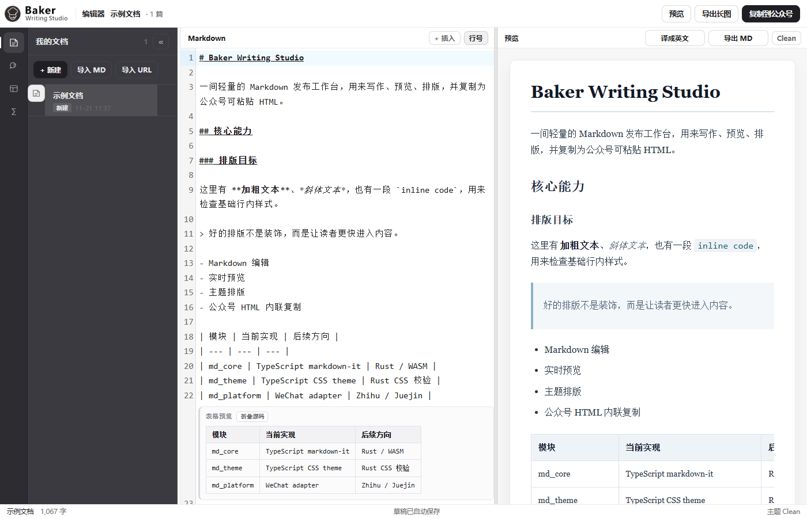
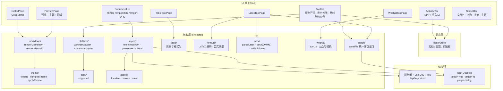

# Baker Writing Studio

**语言 / Languages：** 中文 | [English](README-EN.md)

面向个人写作流程的 Markdown 工作台：在编辑器、实时预览与主题化输出之上，集成 **微信公众号 → Markdown**、**Markdown 表格 → Markdown / LaTeX**、**LaTeX 公式 → LaTeX / Word (.docx)** 三个独立工具，并补强文档库的本地 Markdown 导入能力。

[](LICENSE)
[](https://github.com/ingeniousfrog/Read2MD-Studio)
[](https://github.com/mo21cn/Read2MD-Studio/releases)

> **关于本项目**
> Baker Writing Studio 是对 [ingeniousfrog/Read2MD-Studio](https://github.com/ingeniousfrog/Read2MD-Studio)（Apache License 2.0）的 fork。原项目由 ingeniousfrog 创建并以 Apache License 2.0 发布；本 fork 在保留原始 `LICENSE` 与版权声明的前提下进行了品牌重构、功能扩展与本地化定制。**分发本软件时请完整保留上游 `LICENSE` 文件与原作者致谢。**
>
> 上游版权：Copyright (c) ingeniousfrog and contributors. Licensed under the Apache License, Version 2.0.



**核心工作流：**

```text
Markdown 编辑 → 实时预览 → 主题样式 → 平台适配 HTML → 剪贴板
三个独立工具：公众号 → MD · 表格 → MD/LaTeX · 公式 → LaTeX/Word
```

提供 **Web 版**（浏览器访问）和 **桌面版**（Tauri 打包，当前发布 **Windows** 安装包，macOS 可自行构建）。业务逻辑集中在 TypeScript `core/` 层，UI 只负责组合与交互，便于扩展多个内容平台与文件格式适配器。

---

## 下载与安装

| 平台 | 安装包 | 状态 |
|------|--------|------|
| Windows 10/11 (x64) | [`Baker-Writing-Studio_0.3.1_x64-setup.exe`](https://github.com/mo21cn/Read2MD-Studio/releases/download/v0.3.1/Baker-Writing-Studio_0.3.1_x64-setup.exe) | ✅ 已发布（约 6 MB） |
| macOS Apple Silicon (arm64) | `Baker-Writing-Studio_0.3.1_aarch64.dmg` | 需在 macOS 上自行构建，见「本地构建」 |
| Web | `npm run build` 产出 `dist/`，静态托管即可 | ✅ |

安装包由 CI 工作流 [Build Windows Installer](.github/workflows/build-windows.yml) 产出，也可以在本地自行构建。

### Windows 安装提示

- 适用于 **Windows 10 / 11，64 位（x64）**
- 需要系统已安装 **Microsoft Edge WebView2**（Win10/11 通常已自带；缺失时运行安装包会提示安装）
- 双击安装包运行 NSIS 安装向导，完成后从开始菜单或桌面快捷方式启动
- 安装包**未做代码签名**，Windows SmartScreen 可能提示「未知发布者」，选择「更多信息 → 仍要运行」即可

### macOS 安装提示

本项目尚未发布 macOS 安装包；在 macOS 上自行构建后，dmg 为 **ad-hoc 签名、未公证**。若 Safari 下载后提示「已损坏」或无法打开，请在终端执行后重试：

```bash
xattr -cr "/Applications/Baker Writing Studio.app"
```

也可在「应用程序」中 **右键 Baker Writing Studio → 打开**（首次需确认一次）。

---

## 使用说明

### 界面导览

桌面版与 Web 版使用同一套界面，结构如下：

| 区域 | 位置 | 作用 |
|------|------|------|
| **活动栏** | 最左侧竖排图标 | 四个独立工具入口：**编辑器** / **公众号 → MD** / **表格转换** / **LaTeX** |
| **顶栏** | 顶部横条 | 品牌标识、当前文档与视图切换、**预览**开关、**导出长图**、**复制到公众号** |
| **文档侧栏** | 顶栏下方左侧 | 文档列表，以及 **+ 新建** / **导入 MD** / **导入 URL** |
| **工作区** | 中部 | 编辑器（左）与预览区（右），可拖动分隔条调整比例；三个工具页共用同一块画布 |
| **状态栏** | 底部 | 当前文档名、字数、当前操作状态、当前主题 |

> 活动栏上的四项是**四个独立工具**，不是同一份工作区的不同视图。切到工具页时编辑器视图会保留在后台，工具的输出可以一键送回正文。

### 核心工作流：从 Markdown 到公众号

1. 在文档侧栏 **+ 新建** 建一篇文档，或用 **导入 MD** / **导入 URL** 灌入已有内容
2. 在左侧编辑器撰写 Markdown —— 可直接 **粘贴 / 拖放图片**，也可用编辑器右上角 **+ 插入** 插入图片、表格、公式、链接、分隔线
3. 右侧预览区实时渲染；页眉的主题下拉框切换排版主题
4. 顶栏 **复制到公众号** —— 重新走一遍「主题包裹 → CSS 内联 → HTML 消毒 → 公式保护 → 图片内嵌」管线，同时写入 `text/html` 与 `text/plain`
5. 到公众号后台或其他富文本编辑器里直接粘贴

预览区 DOM **不会**被直接复制：每次点击「复制到公众号」都重新生成，保证输出与当前主题、当前内容一致。

### 文档库与导入

| 方式 | 入口 | 说明 |
|------|------|------|
| 新建 | 侧栏 **+ 新建** | 建空白文档 |
| 本地 Markdown | 侧栏 **导入 MD** | 选择 `.md` / `.markdown` 文件，一键建档并切为当前文档 |
| URL 导入 | 侧栏 **导入 URL** | 粘贴文章链接。桌面版走应用内 HTTP 通道，**无浏览器 CORS 限制**；Web 开发态由本地代理抓取，生产部署需自建等效 API |
| 公众号文章 | 同上 | 自动转 Markdown，保留代码块、公式、表格、引用块与彩色标题等样式 |

草稿与主题配置会自动保存到本地，刷新或重开应用不丢。

### 图片

- **粘贴 / 拖放**：编辑器里粘贴或拖入图片，自动存为本文档的本地资源
- **导入时本地化**：URL 导入会自动把外链图片下载到每篇文档自己的 `assets/{docId}/` 目录，Markdown 里改写为 `baker-asset:` 引用
- **预览与删除**：预览时自动解析本地引用；删除文档时一并清理对应资源目录
- **复制到公众号**：会尝试把外链图片内嵌为 data URL；跨域失败的图需要在公众号后台手动上传

### 主题

- 内置 `clean` / `tech` / `wechat-card` 三套主题
- **主题配置**面板可微调 token（字号、颜色、间距、标题样式等），支持增删 H1–H6 标题级别
- 自定义主题可保存为预设，也可导出 / 导入 JSON 备份

### 三个独立工具

从活动栏切换。

| 工具 | 用途 | 输出 |
|------|------|------|
| **公众号 → MD** | 粘贴微信公众号文章 HTML 或纯文本 | 干净的 Markdown（保留代码块、公式、列表、引用） |
| **表格转换** | 粘贴 Markdown / HTML / 文本对齐的表格片段 | 规范化 Markdown 表格，或 LaTeX `tabular` 环境（格式与对齐方式可切换） |
| **LaTeX** | 粘贴 LaTeX 源码或图片公式 | 可直接粘贴的 LaTeX 源码；含 **OMML 原生嵌入公式** 的 Word `.docx`（在 Microsoft Word 里能继续编辑公式） |

三个工具页与主编辑器共享文档库：公众号转出的结果可一键落库；表格与公式工具的输出可复制，也可导出为文件。

### 全文翻译

预览区页眉的 **译成英文 / 译成中文** 可一键翻译整篇。

- 目标语言由文档主语言推导（判定时先剔除代码块）
- **结构保护**：代码块整块跳过；行内代码、`$...$` 公式、链接与图片地址、HTML 标签以占位符保护，译文回填后原样还原
- **对照文档**：中英逐句对照时自动去重，等价译文保留原文手写版本
- 翻译中显示 `done/total`，可随时取消；取消后文档保持不变
- 完成后按钮变为 **还原原文**，一键恢复；已手动编辑过则不再提供，避免覆盖新内容
- 引擎为公共 Google 翻译端点，**无需 API Key**；单行失败保留原文并在状态栏提示，全篇失败则不改动文档

### 导出

| 导出物 | 入口 | 桌面版行为 |
|--------|------|-----------|
| Markdown | 预览区页眉 **导出 MD** | 系统保存对话框 → 写入 `.md`（带 UTF-8 BOM，Excel / 记事本不乱码） |
| 长图 | 顶栏 **导出长图** | 系统保存对话框 → 写入整篇预览的高清 PNG |
| LaTeX 源码 | LaTeX 页 **导出 .tex** | 系统保存对话框 → 写入 `.tex`（不带 BOM，LaTeX 编译器才认） |
| Word 文档 | LaTeX 页 **导出 Word** | 系统保存对话框 → 写入 `.docx` |
| 主题 JSON | 主题配置面板菜单 **导出主题** | 系统保存对话框 → 写入 `.json` |

> 桌面版的导出**全部走系统原生保存对话框**；Web 版走浏览器下载。

### 数据存放位置

| 数据 | 桌面版 | Web 版 |
|------|--------|--------|
| 文档、主题、草稿 | `%LOCALAPPDATA%\com.baker.writing.studio\EBWebView\Default\Local Storage\` | 浏览器 localStorage |
| 本地化图片 | `%APPDATA%\com.baker.writing.studio\read2md-studio\assets\{docId}\` | 浏览器 IndexedDB |
| 日志 | `%LOCALAPPDATA%\com.baker.writing.studio\logs\` | 浏览器控制台 |

> 图片目录里的 `read2md-studio` 是改名前的历史目录名，为保证老文档的图片不失效而原样保留，不是遗留 bug。

**无云同步、无账号体系**：数据只在这台机器上，换机器请用「导出 Markdown」手动迁移。

### 桌面版与 Web 版差异

| 能力 | Web 版 | 桌面版（Tauri） |
|------|--------|-----------------|
| Markdown 编辑 / 预览 / 主题 | ✅ | ✅ |
| 复制到公众号 | ✅ | ✅（原生剪贴板 API，长文更稳） |
| URL 导入（含图本地化） | 开发态有代理；生产需自建 API | ✅ 原生 HTTP，无 CORS 限制 |
| 本地 Markdown 导入 | ✅ | ✅ |
| 三个独立工具 | ✅ | ✅ |
| 公式 → Word（原生 `.docx` + OMML） | ✅ | ✅ |
| 导出到磁盘 | 浏览器下载 | ✅ 系统原生保存对话框 |
| 离线使用 | ✗ | ✅ |

### 常见问题

**Q：安装时 SmartScreen 提示「未知发布者」。**
安装包未做代码签名。点「更多信息 → 仍要运行」即可。

**Q：导入某个公众号链接失败，提示需要验证。**
部分公众号文章会对非常规网络环境触发人机验证。换一个网络环境或手动把文章内容粘贴到「公众号 → MD」工具。

**Q：复制到公众号后图片是裂的。**
外链图床不允许跨域内嵌。桌面版的图片本地化只覆盖「导入」与「粘贴插入」的图；正文里手写的图片链接需要在公众号后台手动上传，或先用「导入 URL」把整篇重新导入。

**Q：翻译长文很慢或中途失败。**
翻译走公共端点，有速率限制。失败行会保留原文并在状态栏提示；文档较长时建议分段处理。

**Q：公式在预览里不显示。**
公式需要 MathJax 首次加载，稍等一拍即可；若一直不显示，检查网络是否能访问公式渲染所需的资源。

---

## 开发

### Web 版

```bash
npm install
npm run dev -- --host 127.0.0.1 --port 3000
```

打开 http://127.0.0.1:3000/

### 桌面版

**依赖：**

- [Rust](https://www.rust-lang.org/tools/install) 1.77+
- macOS：Xcode Command Line Tools
- Windows：[Visual Studio 2022 Build Tools](https://visualstudio.microsoft.com/downloads/)，需勾选「使用 C++ 的桌面开发」（含 MSVC 编译器与 Windows SDK）；运行时需 **Microsoft Edge WebView2**

```bash
# 开发模式（原生窗口）
npm run tauri:dev

# 本地打包（产物因平台而异）
npm run tauri:build          # 按当前平台自动选择：Windows → nsis，macOS → dmg
npm run tauri:build:nsis     # 仅 Windows NSIS 安装包
npm run tauri:build:dmg      # 仅 macOS DMG 镜像

# macOS：src-tauri/target/release/bundle/dmg/Baker Writing Studio_0.3.1_aarch64.dmg
# Windows：src-tauri/target/release/bundle/nsis/Baker Writing Studio_0.3.1_x64-setup.exe
```

> `bundle.targets` 不能同时列出 NSIS 与 DMG：NSIS 只能在 Windows 上打包，DMG 只能在 macOS 上打包，硬写在一起会让 `tauri build` 在两个平台上都失败。因此配置项保持平台默认（`"all"`），实际目标由 `scripts/build-desktop.mjs` 按当前平台显式传给 `--bundles`。

### 生产构建（Web）

```bash
npm run build     # 输出 dist/
npm run preview   # 本地预览 dist
```

### 开发命令

| 命令 | 说明 |
|------|------|
| `npm run dev` | 启动 Vite 开发服务器 |
| `npm run build` | TypeScript 检查 + 生产构建 |
| `npm run preview` | 预览生产构建 |
| `npm run tauri:dev` | Tauri 开发模式（原生窗口） |
| `npm run tauri:build` | 按当前平台构建桌面安装包（Windows：exe；macOS：dmg） |
| `npm run tauri:build:nsis` | 仅构建 Windows NSIS 安装包（`.exe`） |
| `npm run tauri:build:dmg` | 仅构建 macOS DMG 镜像（`.dmg`） |
| `npm test` | 运行单元测试（Vitest） |
| `npm run lint` | ESLint 检查 |
| `npm run version:sync` | 把 `package.json` 的版本同步到 Tauri 与 Cargo 清单 |
| `npm run verify:version` | 校验三处版本号一致（CI 会跑） |

---

## 架构

项目分为四层：**UI 组件**、**状态管理**、**核心业务**、**运行时**。



### 目录结构

```text
src/
  App.tsx                 # 布局：活动栏 + 顶栏 + 视图槽 + 状态栏
  components/             # 纯 UI 组件，不含业务规则
    ActivityRail.tsx      # 左侧活动栏：编辑器 / 公众号 / 表格 / LaTeX
    TopBar.tsx            # 顶栏：品牌、视图、预览开关、导出长图、复制到公众号
    StatusBar.tsx         # 底部状态栏
    CanvasPane.tsx        # 工具页与编辑器共用的画布容器
    WorkspaceSplit.tsx    # 可拖拽分栏
    DocumentList.tsx      # 文档列表、Import MD / Import URL、重命名/删除
    EditorPane.tsx        # Markdown 编辑器（含图片粘贴/拖放、斜杠命令）
    editorImageExtension.ts / editorBlockWidgets.ts / editorInlineWidgets.ts
    editorSlashCommands.ts / editorSelectionTools.ts
    PreviewPane.tsx       # 预览区 + 主题选择 + 全文翻译 + 导出 MD
    ThemePanel.tsx        # 主题配置面板
    ThemeSelector.tsx     # 主题下拉（含已保存的自定义主题）
    HeadingLevelsEditor.tsx
    WechatToolPage.tsx    # 公众号 → Markdown 工具
    TableToolPage.tsx     # 表格 → MD/LaTeX 工具
    LatexToolPage.tsx     # LaTeX → LaTeX/Word 工具
    BrandLogo.tsx         # chef-hat 标识
    ImportDialog.tsx      # URL 导入对话框
    InsertMenu.tsx / SelectionBubble.tsx / DocTypeIcon.tsx / PaneHeader.tsx
  core/
    markdown/             # Markdown → HTML、公式与 Mermaid
    theme/                # 主题 token、CSS 编译、包裹 HTML
    platform/             # 平台适配（当前：微信公众号）
    copy/                 # 剪贴板写入
    import/               # URL 抓取、HTML 解析、转 Markdown
    assets/               # 图片下载、本地化、预览解析、用户粘贴保存
    export/               # saveFile.ts —— 统一落盘出口
    document/             # 文档类型定义
    wechat/               # 公众号 → MD 工具实现
    table/                # 表格 → MD/LaTeX 工具实现
    formula/              # 公式模型与序列化
    latex/                # LaTeX 解析、Word(OMML) 生成、转 Markdown
    translate/            # 全文翻译：分段、占位符保护、请求、回填
    editor/               # 编辑器辅助逻辑
    tools/                # 草稿等工具级状态
  store/
    editorStore.ts        # Zustand 全局状态 + localStorage 持久化
  fixtures/               # 示例文档
  i18n/                   # i18next 初始化与中文语言包
  styles/
    globals.css
server/                   # 仅开发态：Vite 中间件调用的 Node 抓取脚本
src-tauri/                # Tauri 桌面壳（Rust）
scripts/
  sync-version.mjs        # 版本号单源
  build-desktop.mjs       # 按平台选择打包目标
```

**设计原则：** React 组件只调用 `core/` 接口；渲染、主题、平台适配、消毒、剪贴板、落盘逻辑均与 UI 解耦，方便单独测试和扩展。

### 核心数据流

**1. 预览渲染**

```text
Markdown
  → renderMarkdown()        # markdown-it + 自定义 mathPlugin
  → rawHtml
  → applyThemeHtml()        # 包裹 .baker-article + 主题 CSS
  → 预览区 DOM
```

公式由 MathJax 输出为 **自包含 SVG**（`fontCache: "none"`），避免粘贴后 `<use>` 引用丢失。

**2. 复制到公众号**

```text
rawHtml
  → applyThemeHtml()
  → buildWechatOutput()
      ① 整块提取公式容器（避免嵌套 SVG 被拆碎）
      ② juice 内联 CSS
      ③ DOMPurify 消毒
      ④ 外链图片尝试转 data URL
      ⑤ 还原公式 HTML
  → copyHtml()              # 同时写入 text/html + text/plain
```

**3. URL 导入**

```text
用户输入 URL
  → fetchImportUrl()
      浏览器：/api/import-url（Vite → server/*.mjs）
      桌面端：@tauri-apps/plugin-http
  → parseWechatHtml() / parseGenericHtml()
      提取代码块、公式占位符
  → htmlToMarkdown()        # Sitdown + Turndown
  → localizeDocumentImages() # 外链图下载至 assets/{docId}/
  → 写入编辑器
```

**4. 统一落盘（导出）**

```text
任意导出动作
  → core/export/saveFile.ts
      Web：Blob → a[download]
      桌面端：base64 → IPC → save_bytes Rust 命令
              → 原生保存对话框取路径 → std::fs::write
```

保存路径**恒来自原生对话框**，命令不会写到用户没指过的地方。

---

## 贡献

参见 [CONTRIBUTING.md](CONTRIBUTING.md)。提交前请确保：

```bash
npx tsc -b          # 类型检查
npm run lint        # ESLint
npm test            # 单元测试
npm run verify:version
```

安全问题请见 [SECURITY.md](SECURITY.md)。

---

## 更新日志

完整更新日志见 [CHANGELOG.md](CHANGELOG.md)。

---

## 致谢

本项目站在诸多优秀开源项目之上，特别感谢：

| 项目 | 用途 |
|------|------|
| [markdown-it](https://github.com/markdown-it/markdown-it) | Markdown 解析与 HTML 渲染 |
| [MathJax](https://github.com/MathJax/MathJax) | LaTeX 公式 → SVG |
| [CodeMirror](https://github.com/codemirror/dev) / [react-codemirror](https://github.com/uiwjs/react-codemirror) | 编辑器内核与 React 封装 |
| [highlight.js](https://github.com/highlightjs/highlight.js) | 代码块语法高亮 |
| [juice](https://github.com/Automattic/juice) | CSS 内联（公众号富文本必需） |
| [DOMPurify](https://github.com/cure53/DOMPurify) | 复制前 HTML 消毒 |
| [Sitdown](https://github.com/mdnice/sitdown) | 公众号 / 知乎等 HTML → Markdown |
| [Turndown](https://github.com/mixmark-io/turndown) | 通用 HTML → Markdown |
| [Tauri](https://github.com/tauri-apps/tauri) | 跨平台桌面壳 |
| [Mermaid](https://github.com/mermaid-js/mermaid) | 预览区流程图 / 时序图渲染 |
| [docx](https://github.com/dolanmiu/docx) · [math](https://www.npmjs.com/package/math) | Word `.docx` 生成与 OMML 嵌入 |
| [React](https://github.com/facebook/react) · [Vite](https://github.com/vitejs/vite) · [Zustand](https://github.com/pmndrs/zustand) | UI 框架、构建工具与状态管理 |

并向 **[ingeniousfrog/Read2MD-Studio](https://github.com/ingeniousfrog/Read2MD-Studio)** 致以最深的谢意 —— 本项目是站在其肩膀上的再发行版本。如有遗漏，欢迎提 Issue 补充。

---

## 许可证

本项目采用 [Apache License 2.0](LICENSE)。

上游 README 与品牌资产的版权属各自作者所有；本 fork 在保留原始 `LICENSE` 文件与原作者版权声明的前提下进行再发行。各依赖包的具体许可证以各自仓库为准；分发本软件时请保留 `LICENSE` 文件。

---

## 当前限制

- **Mermaid 复制到公众号**：预览可渲染图表，但复制到公众号时 Mermaid 仍以代码块或文本形式粘贴，尚未转为图片/SVG 内嵌
- **尚无图床 / CDN**：桌面版与 Web 开发态可将图片存为本地 `assets`（导入下载、粘贴插入），但复制到公众号时部分外链图仍可能因跨域无法内嵌，需在后台手动上传
- **Web 生产部署**暂无 URL 抓取代理与完整图片本地化，含图工作流建议用桌面版
- 仅实现微信公众号复制适配，知乎 / 掘金等平台待扩展
- 无云同步与用户账号体系；图片与草稿仅存本机
- macOS 桌面版为 ad-hoc 签名、未公证；Windows 安装包未签名，SmartScreen 可能提示未知发布者
- 部分公众号文章导入可能触发环境验证，与网络环境有关
- **全局翻译依赖公共翻译端点**：无需 API Key，但长文批量翻译受端点限速影响；失败行保留原文并提示
- **界面仅中文**：早期版本的中英文切换已移除，界面文案锁定为中文
